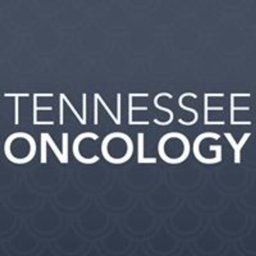
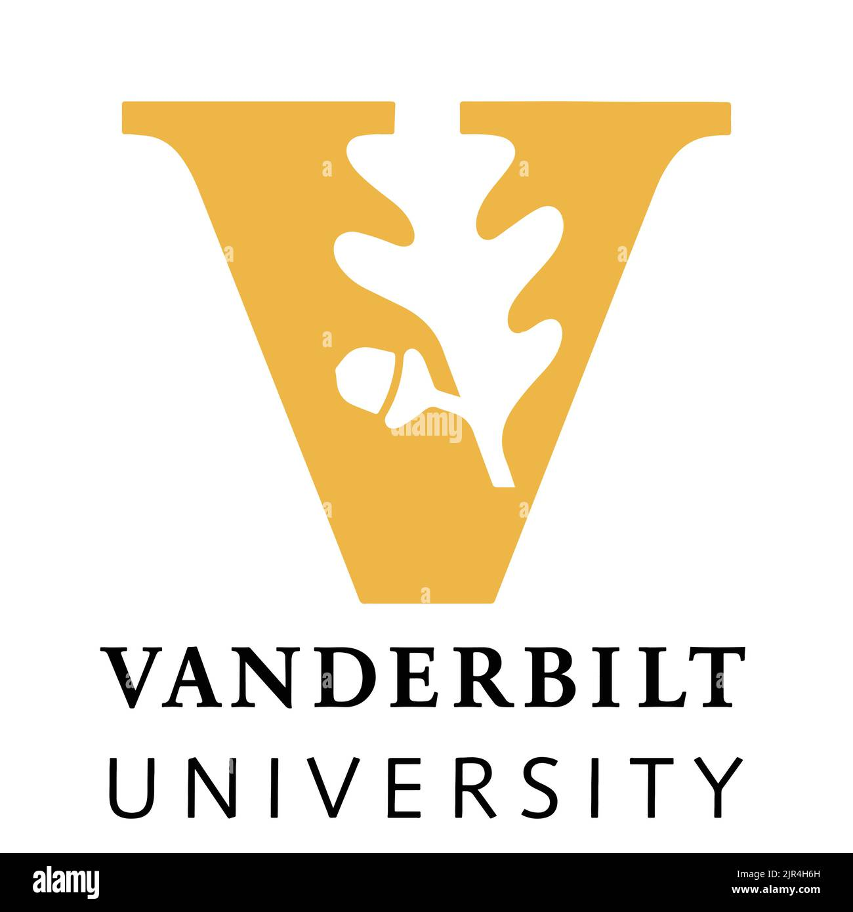

[<i class="bi bi-download"></i> Download Resume](GloriaBazilevichFullcv062126.pdf){.btn .btn-primary role="button"}

## Current Role

## Research Assistant IV

 **Case Western Reserve University** \| Molecular Biology & Microbiology \| Cleveland, OH\
*2024 – Present*

- **Focus:** single-cell library preparation workflows, BSL2+ sample extraction, and HIV genomics research.

------------------------------------------------------------------------

## Diagnostic & Clinical Research Experience

### Molecular Technologist

**Tennessee Oncology** \| Molecular & Genomics Studies \| Nashville, TN\
*2021 – 2024*

- **Focus:** high-complexity clinical diagnostics, including DNA/RNA extractions, NGS, RT-PCR, and LIMS-based sample tracking.

## Academic & Biophysical Research Experience

### Research Assistant

**Vanderbilt University** \| McCawley Lab \| Nashville, TN\
*2016 – 2021*

- **Focus:** microfluidic device fabrication, mouse colony breeding, and quantitative tissue culture imaging.

### Undergraduate Student Researcher

**Kent State University** \| Kooijman Lab \| Kent, OH\
*2014 – 2015*

- **Focus:** NMR spectroscopy analysis of lipid-lipid interactions and scientific data presentation.

## Publications

**Ionization Properties of the enigmatic plant lipid DGPP**\
**Bazilevich, G.**, Budge, K. Rapovy, S. Khalifa, H. Koukounas, Y. Graber, Z., & Kooijman, E. E.\
*The FASEB Journal* (2015) \| [View Publication](https://faseb.onlinelibrary.wiley.com/doi/10.1096/fasebj.29.1_supplement.715.36) ---
